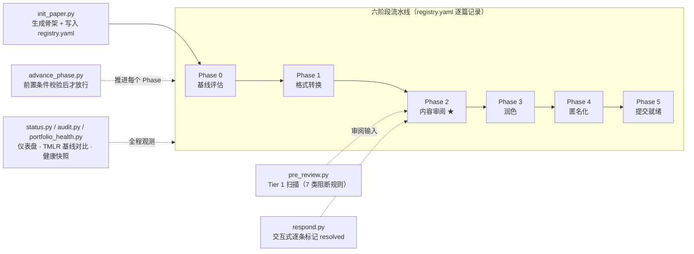

# Loop Engineering v4.0

[](https://github.com/aidless/loop-engineering/actions/workflows/ci.yml)

[](LICENSE)

> 从单论文循环到跨论文智能审阅系统

## 这个项目解决什么问题 / 为什么重要

每篇论文的审阅若从零开始，发现的模式无法跨论文复用。Loop Engineering 把审阅从
「单篇一次性」升级为「跨论文智能系统」：以**可复用规则**（`rulebook.yaml`）、**TMLR
已发表基线**（`tmlr_baselines.yaml`）、**跨论文模式关联**（`cross_ref.yaml`）为中枢，
让每篇新论文站在之前所有审阅的肩上。它的价值是**把审阅经验沉淀成资产**，而不是每次
重新发明轮子。

## 我用了什么方法

- **六阶段流水线**：Phase 0（基线评估）→ 1（格式转换）→ 2（内容审阅★）→ 3（润色）
  → 4（匿名化）→ 5（提交就绪），每阶段有前置条件、退出标准、最大轮次限制。
- **三层审阅规则**：Tier 1（阻断，7 条）/ Tier 2（高优，10 条）/ Tier 3（润色，8 条），
  从真实审阅实践提取，`rulebook.yaml` 共 47 条（含 defense/tier_2_plus/stats）。
- **TMLR 基线对标**：5 篇已发表 TMLR 论文的关键特征（数据集数、模型数、CI/效应量报告率）
  收录为基线，自动对比你的论文与 TMLR 中位数的差距。
- **跨论文关联**：`cross_ref.yaml` 定义模式传播规则（如「某问题在 A 出现 → 应检查 B」）。

## 结果如何

- **可运行的仪表盘**：`python status.py --all` 输出 6 篇论文的全局状态、TMLR 基线中位数
  （数据集 4 / 模型 3 / CI 0% / 效应量 0% / 中位分 7.0）。
- **可运行的组合工具**：`portfolio_health.py`（组合健康度，6 篇，1 篇就绪）、
  `cross_review.py`（跨论文扫描，但需要 main.tex 在场才产生报告——当前仓库内没有
  `../Research/` 论文源，故运行会提示 "No papers with main.tex found"）。
- **诚实缺口**：`pre_review.py` 仅实现 Tier 1（硬编码检查），`--tier 2/3` 与 `--json`
  为预留接口，`rulebook.yaml` 未接入脚本——README 已如实标注。

## Fail-closed 声明

本系统对「未满足前置条件就推进」**默认 fail-closed**（`advance_phase.py`）：

- **阶段推进门**：`advance_phase.py` 校验每阶段前置条件（Phase 1 编译 0 错误、Phase 2 无未解决 critical、Phase 4 零身份泄漏、Phase 5 用户手动签核）。任一不满足且未 `--force`/`--dry-run` → `sys.exit(1)` **拒绝推进**。Phase 5 的签核检查**恒返回 False**——必须用户手动确认或 `--force`，绝不自动放行。
- **审计门**：`audit.py` 按优先级分类（P0 = **DESK REJECT RISK**，P1 = reviewer will ask，P2 = polish），`verdict` 阈值：score ≥8 READY / ≥6 REVISION NEEDED / else **NOT READY**——P0 未清即不可提交。
- **诚实缺口**：`rulebook_full.yaml` 不存在、`pre_review.py` 仅 Tier 1、`../Research/` 不在场——README 如实标注，不把「缺」说成「有」。

> 立场：宁可 `exit(1)` 拒绝推进，也不在未满足前置条件时放行；宁可标注缺口，也不声称未验证的能力。

## 边界声明（证明什么 / 不证明什么）

**证明（可复算）**：① 所有 Python 脚本通过 `python -m compileall -q .`（CI 验证）；②
`rulebook.yaml` 三层规则数（7/10/8）与 `tmlr_baselines.yaml` 基线中位数（4/3/0%/0%/7.0）
与仓库文件一致；③ `status.py --all` 与 `portfolio_health.py` 可运行并产出结构一致的结果。
**不证明**：① 未声称「审阅已提升论文质量」——仓库内没有 `../Research/` 论文源（registry
路径指向外部 `../Research/`，当前不存在），**没有任何论文在仓库内完成过实际审阅循环**；
② 未声称规则库已机器化——`pre_review.py` 只实现 Tier 1 硬编码检查，Tier 2/3 与
`rulebook.yaml` 尚未接入；③ 未声称 82 条完整规则已入库——`rulebook_full.yaml` 不存在，
README 对此保持公开缺口。

## 复算（Reproduction）

```bash
cd loop-engineering
# 1) 全局仪表盘（6 篇论文 + TMLR 基线中位数）
python3 status.py --all
# 2) 组合健康度
python3 portfolio_health.py
# 3) 编译检查（CI 的核心验证）
python3 -m compileall -q . ; echo $?   # 期望 0
# 4) 规则数与基线核对
python3 -c "import yaml; d=yaml.safe_load(open('rulebook.yaml')); print('tier_1',len(d['tier_1']),'tier_2',len(d['tier_2']),'tier_3',len(d['tier_3']))"
python3 -c "import yaml; d=yaml.safe_load(open('tmlr_baselines.yaml')); print('baselines',len(d['baselines']))"
# 5) 预审阅（对仓库内任一论文；因 ../Research 缺失会提示找不到 main.tex）
python3 pre_review.py PAPER-A
```

> **诚实说明**：`../Research/` 目录不存在，故 `pre_review.py` / `quality_checks.py` /
> `cross_review.py` 对仓库内注册论文会提示 "main.tex not found" 或 "Paper not found"。
> 这是**路径依赖的运行时行为**，不是仓库缺陷；工具需要论文源在场才能产生完整输出。

## 设计理念

**问题**: 每篇论文从零开始审阅，发现的模式无法跨论文复用。

**方案**: 本仓库即全局中枢——存放可复用规则、TMLR 基线、跨论文关联；每个论文实例的工作目录由 `registry.yaml` 登记。工具脚本全部位于仓库**根目录**（更早的版本把它们放在 `.loop/` 下，该目录已不存在）。

## 快速开始

```bash
# 查看全部论文状态
python status.py --all

# 初始化新论文
python init_paper.py my_paper "My Paper Title" --venue TMLR

# 对新论文运行自动预审阅
python pre_review.py my_paper

# 推进论文阶段（带前置条件校验）
python advance_phase.py my_paper

# 交互式回复审稿意见
python respond.py PAPER-A
```
> 注意：当前 `pre_review.py` 仅实现 Tier 1（内置硬编码检查）；`--tier 2/3` 与 `--json` 为预留接口，`rulebook.yaml` 暂未接入脚本。

## 目录结构

```
loop-engineering/
├── *.py                            ← 全部工具在仓库根目录（不在 .loop/ 下）
│   ├── status.py                   ← 全局仪表盘 + TMLR 基线对比
│   ├── pre_review.py               ← 自动预审阅扫描器（Tier 1）
│   ├── init_paper.py               ← 论文骨架初始化器
│   ├── advance_phase.py            ← 阶段推进
│   ├── respond.py                  ← 审稿回复工具
│   ├── agent_review.py / cross_review.py / review_engine.py
│   ├── audit.py / submission_audit.py / paper_quality.py
│   ├── citation_checker.py / scholar_verify.py / latex_check.py
│   └── portfolio_health.py / quality_checks.py / dual_submit.py
├── registry.yaml                   ← 论文注册表
├── rulebook.yaml                   ← 可自动化审阅规则（47 条，含 tier_1/2/3 + defense/tier_2_plus/stats）
├── tmlr_baselines.yaml             ← TMLR 已发表论文基线（5 篇）
├── cross_ref.yaml                  ← 跨论文模式关联
├── templates/phase_template.yaml
├── snapshots/                      ← 历史健康快照（append-only）
├── reviews/                        ← 单论文评审记录（如 PAPER-E_review.json）
├── reports                         ← 跨论文元审阅报告（**文件**，非目录）
└── PAPER_B/ ...（注册在 registry.yaml，路径指向 ../Research/，不在本仓库内）
```

> **注意**：`docs/` 目录**不存在**；`reports` 是**一个生成报告文件**，不是目录。仓库内没有
> `docs/` 与独立 `reports/` 目录——本 README 早期版本对此的表述已更正。

## 五个核心工具

| 工具 | 命令 | 功能 |
|------|------|------|
| `status.py` | `python status.py --all` | 全局仪表盘 + TMLR 基线对比 |
| `init_paper.py` | `python init_paper.py ID "Title"` | 一键生成论文骨架 |
| `pre_review.py` | `python pre_review.py ID` | 自动扫描 Tier 1 规则（7类阻断问题） |
| `respond.py` | `python respond.py ID` | 交互式审稿回复，逐条标记 resolved |
| `advance_phase.py` | `python advance_phase.py ID` | 校验前置条件后推进阶段 |

## 六阶段流水线

```
Phase 0 (基线评估) → Phase 1 (格式转换) → Phase 2 (内容审阅★)
  → Phase 3 (润色) → Phase 4 (匿名化) → Phase 5 (提交就绪)
```

每个 Phase 有前置条件、退出标准、最大轮次限制。

工具与流水线的真实对应关系（据仓库根目录的工具集绘制）：



## 审阅规则库

从 3 篇论文的 11 轮审阅中提取，分三个 Tier：

- **Tier 1 (阻断)**: 7 条 — C1首次声称、L1遗漏文献、C6内部矛盾、M1混淆变量...
- **Tier 2 (高优)**: 10 条 — L2孤儿引用、S3效应量缺失、S4多重比较...
- **Tier 3 (润色)**: 8 条 — 术语一致性、图表完整性、写作质量...

完整规则以 `rulebook.yaml` 为准；82 条的完整清单条目（`rulebook_full.yaml`）尚未入库——已知缺口，不作声明。

## TMLR 基线对标

5 篇已发表 TMLR 论文的关键特征已收录。自动对比你的论文在统计 rigor、数据集规模、CI/效应量报告等方面与 TMLR 中位数的差距。

## 添加新论文

```bash
# 1. 初始化
python init_paper.py my_paper "Title" --venue TMLR

# 2. 写论文 (编辑 main.tex)

# 3. 运行预审阅
python pre_review.py my_paper

# 4. 修复问题后推进阶段
python advance_phase.py my_paper
```

## 添加新规则

编辑 `rulebook.yaml`，在对应 Tier 下添加新条目：

```yaml
  NEW_rule_id:
    id: NEW
    category: claim_evidence
    description: "What to check"
    auto_check: "grep for 'pattern'"
    severity: critical
```

## 版本历史

| 版本 | 日期 | 变更 |
|------|------|------|
| v4.0 | 2026-07-02 | 全局中枢 + 自动预审阅 + TMLR对标 + 审稿回复追踪 |
| v3.1 | 2026-07-01 | 第三方审阅 + 回归测试 + Git自动提交 |
| v2.0 | 2026-06-28 | 多轮递进式审阅 (快速→深度→对抗→冷重启→终审) |
| v1.0 | 2026-06-27 | 单论文6阶段循环 |

## 验收题库与复算

`eval/cases.jsonl` 是 20 条可执行验收题，覆盖本仓库 16 条轴：audit 的优先级 / 来源 / 归一化，quality_checks 的 CI 覆盖与效应量，latex_check 的合并 bibitem 与 cite/bib 失配，citation_checker 的作者核对与 bib 解析，score_calibrator 的扣分口径，`registry.yaml` / `tmlr_baselines.yaml` / `rulebook.yaml` 三份数据文件的关键数字，`advance_phase.py` 的 Phase 5 fail-closed 边界，以及 `tests/test_repo_integrity.py` 的 test_ 函数条数。期望值不是抄文档——19 条 `expr` 直接 `import` 本仓库模块现算、`yaml.safe_load` 真读数据文件、或用 `ast` 解析测试文件；1 条 `doc` 校 README 自述的 47 条规则：

```bash
python3 eval/run_cases.py            # 20/20 cases passed
python3 eval/run_cases.py --save     # 顺带把结果写进 eval/run-report.json
python3 eval/run_cases.py --selftest # 篡改第一条期望值，必须变红（19/20，证明这套题会失败）
```

**数字如何复算**：`eval/run-report.json` 里每条 case 都带 `id` / `axis` / `detail`，把 `detail` 与 `cases.jsonl` 的 `verify` 代码一起看，就能从源码复现该数字；`--save` 重跑一次即可重建整份报告，不需要手工抄数。

**失败归因**：`run_cases.py` 不只报通过率，失败时按 `axis` 汇总（例如 `audit/priority: 1 条 —— LE-01`），直接指出是哪个模块的哪个口径坏了。
